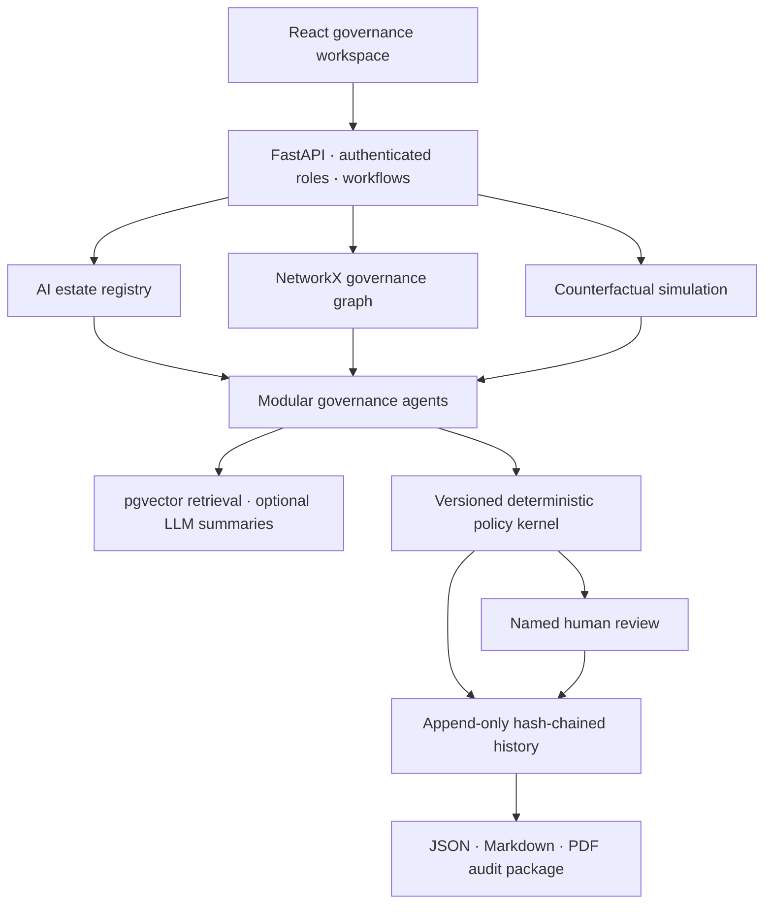

# GovernSim

**A predictive governance digital twin for enterprise AI.**

GovernSim connects an AI estate to representative requirements, controls, evidence and human decisions. Its what-if simulator answers: **what needs to be reassessed if this model, geography, permission, data source or policy changes?**

This is a deployable **local MVP**. It is decision support, not legal advice, a legal applicability engine, an ISO certification or a production enterprise compliance platform. The included enterprise records and attestations are **synthetic demo fixtures**.

## What works

- Seven React workspaces: AI estate, asset profile/graph, evidence, what-if simulator, change impact, human review and audit packages.
- FastAPI API with server-verified roles: AI owner, risk officer, compliance reviewer, auditor and admin.
- Five AI assets, ten controls, thirty authored representative requirements and twenty-five synthetic evidence artifacts.
- Versioned deterministic assessments with five statuses: `COMPLIANT`, `EVIDENCE_GAP`, `HUMAN_REVIEW_REQUIRED`, `CONDITIONAL_APPROVAL`, `BLOCKED`.
- Evidence hashes, freshness/expiry checks, independent verification, coverage metadata and scoped version invalidation.
- Isolated simulations for geography, model/provider, data, permissions, autonomy, prompts, incidents and policy profiles.
- Recorded registry changes reassess transitive dependent assets.
- Mapping proposals require a different named reviewer before activation.
- Hash-chained append-only history, decision snapshots and reviews, plus JSON, Markdown and PDF exports.
- PostgreSQL + pgvector via Docker Compose; SQLite and local cosine retrieval for a quick setup.
- Optional grounded OpenAI or Anthropic summaries. No paid API or model key is needed in offline mode.

## Architecture



LLM output cannot enter the deterministic status calculation. A summary with unknown citation IDs is rejected. Identifier validation does **not** establish semantic entailment; summaries still require human verification.

## Windows: use your Documents\GovernSim folder

Extract this archive's **contents** into your existing `Documents\GovernSim` folder. `README.md`, `compose.yaml`, `backend` and `frontend` should be directly inside it.

### Option A — Docker Desktop (PostgreSQL + pgvector)

Requires Python 3.12+ for credential generation and Docker Desktop with Linux containers.

```powershell
cd "$env:USERPROFILE\Documents\GovernSim"
py -3.12 scripts\bootstrap.py
docker compose up --build -d
```

Open **http://localhost:8000**. Open `.local-keys.txt` locally and paste the token under `AI_OWNER` to use the app. Sign out and use `COMPLIANCE_REVIEWER` to review its evidence/mappings, or `ADMIN` for policy/library administration.

```powershell
# See health and startup errors
docker compose ps
docker compose logs -f app

# Stop the app; the named database volume is retained
docker compose down
```

Do not add `-v` unless you intentionally want to delete the database volume.

### Option B — Python + Node, no Docker

Requires **Python 3.12** and **Node.js 22+**. This path uses SQLite, NetworkX and offline lexical embeddings.

```powershell
cd "$env:USERPROFILE\Documents\GovernSim"
py -3.12 -m venv .venv
.\.venv\Scripts\python.exe scripts\bootstrap.py
.\.venv\Scripts\python.exe -m pip install -r backend\requirements.txt
npm.cmd ci --prefix frontend
npm.cmd run build --prefix frontend
.\.venv\Scripts\python.exe -m uvicorn app.main:app --app-dir backend --host 127.0.0.1 --port 8000
```

Open **http://localhost:8000** and use a token from `.local-keys.txt`. No virtual-environment activation is necessary when you call its Python executable directly.

A convenience launcher is included at `scripts\start-local.ps1`; the explicit commands above also work when PowerShell script execution is restricted. Linux/macOS: `bash scripts/start-local.sh`.

For UI development, run the backend on port 8000 and `npm.cmd run dev --prefix frontend` in another terminal. Open Vite's local URL; `/api` requests are proxied to the backend. Rebuild the UI before serving it from FastAPI.

## First demo

1. Sign in with an **AI_OWNER** token. The seeded India customer-support agent meets the representative controls using synthetic evidence.
2. Open **What-if simulator**, choose that agent, and run the preset EU deployment scenario.
3. Inspect new privacy/transparency requirements, newly insufficient scopes and remediation. EU deployment does not automatically establish an AI Act high-risk use case.
4. Inspect **Evidence** and the source/hash/scope of an artifact. New artifacts always start unverified.
5. Register a high-risk asset or simulate/record an incident. Run an assessment, then use a **COMPLIANCE_REVIEWER** token to record a justified review.
6. Open **Audit packages** and download JSON, Markdown or PDF. Export the full chain and retain its head hash independently.

An executable walkthrough against your running local API is available:

```powershell
.\.venv\Scripts\python.exe scripts\demo.py
```

It registers a new demo agent and writes output packages to ignored `artifacts/`. It leaves unrelated missing evidence gaps open.

## Tests and evaluation

```powershell
.\.venv\Scripts\python.exe -m pip install -r backend\requirements-dev.txt
.\.venv\Scripts\python.exe -m pytest backend\tests -q
.\.venv\Scripts\python.exe scripts\evaluate.py
npm.cmd run build --prefix frontend
```

See [evaluation/REPORT.md](evaluation/REPORT.md), [evaluation/metrics.json](evaluation/metrics.json) and [docs/VERIFICATION.md](docs/VERIFICATION.md). Metrics are measured on small synthetic fixtures; they are not production accuracy estimates. Type compatibility is not a validated semantic mapping benchmark.

A PostgreSQL test is skipped unless `TEST_POSTGRES_URL` points at a **disposable** database. GitHub Actions defines SQLite, PostgreSQL/pgvector and frontend-build jobs. Those CI jobs have not run until the repository is pushed.

## Create the GitHub repository

Target account: **kar151A**. No remote repository is created by extracting these files.

If GitHub CLI is installed and authenticated:

```powershell
cd "$env:USERPROFILE\Documents\GovernSim"
git init -b main
git add .
git commit -m "Build GovernSim governance digital twin MVP"
gh auth login
gh repo create kar151A/GovernSim --private --source . --remote origin --push
```

The remote is private by default. Choose public only if you intend to publish this source. If the repository already exists, inspect it before adding a remote or pushing.

| Command | What it does and why it is used here |
| --- | --- |
| `git init -b main` | Starts version tracking in this folder and names the initial branch `main`. |
| `git add .` | Stages the project's files for the first snapshot. `.gitignore` excludes credentials, local databases and dependencies. |
| `git commit -m "..."` | Records the staged snapshot in local Git history. |
| `gh auth login` | Authenticates GitHub CLI as your GitHub account. Complete this locally; never paste passwords or tokens into chat. |
| `gh repo create ... --private --source . --remote origin --push` | Creates the private remote, connects this folder as `origin`, and uploads the initial commit. |

Alternatively create an empty repository at **https://github.com/new** under `kar151A`, named `GovernSim`, without adding an initial README. After the first three Git commands above:

```powershell
git remote add origin https://github.com/kar151A/GovernSim.git
git push -u origin main
```

`git remote add` records where this folder should push; `git push -u` uploads `main` and remembers its upstream for later pushes.

## Configuration

`python scripts/bootstrap.py` is idempotent and never overwrites an existing `.env`. It generates random local tokens and a random database password. The server holds only token hashes; role/name assignments are server controlled. `.local-keys.txt` holds the original credentials and is excluded from Git and Docker builds. Keep it private.

| Variable | Purpose |
| --- | --- |
| `GOVERNSIM_API_KEYS` | JSON object mapping SHA-256 token hashes to `{name, role}`. Empty configuration refuses startup. |
| `POSTGRES_PASSWORD` | Generated hexadecimal password used by Compose. |
| `DATABASE_URL` | SQLAlchemy URL; omitted for local SQLite, supplied automatically by Compose. |
| `SEED_DEMO` | Explicit synthetic seeding; bootstrap enables it for the demo. Set `false` before a clean non-demo deployment. |
| `LLM_PROVIDER` | `offline` (default), `openai` or `anthropic`. |
| `LLM_API_KEY`, `LLM_MODEL` | Needed only for optional online summaries; choose a model available to your account. |

Changing a PostgreSQL password in `.env` does not rotate a password already initialized in an existing database volume. Rotate it within PostgreSQL and then update configuration.

## Implementation guide

```text
backend/app/
  main.py       authenticated API and workflows
  schemas.py    strict request validation
  db.py         relational tables and append-only triggers
  catalog.py    controls, representative requirements and policy profiles
  kernel.py     pure deterministic assessment engine
  agents.py     ingestion, indexing, retrieval, mapping proposals, summaries
  service.py    assessment, change impact and isolated simulation
  audit.py      canonical serialization and hash-chain integrity
  seed.py       explicitly synthetic enterprise fixtures
  reports.py    evidence package composition and exports
backend/tests/  regression and opt-in PostgreSQL checks
frontend/src/   typed React workspaces and responsive styles
scripts/        local setup, demo and evaluation
```

API documentation: **http://localhost:8000/docs**. Click **Authorize** and enter a local token. Root endpoint aliases match the supplied brief; the UI uses `/api/*` to avoid path collisions with frontend assets. See [docs/API.md](docs/API.md).

See [docs/DECISION_MODEL.md](docs/DECISION_MODEL.md) for evidence/review semantics, [docs/SOURCES.md](docs/SOURCES.md) for authority and scope, and [docs/DEPLOYMENT.md](docs/DEPLOYMENT.md) before any hosted deployment.
