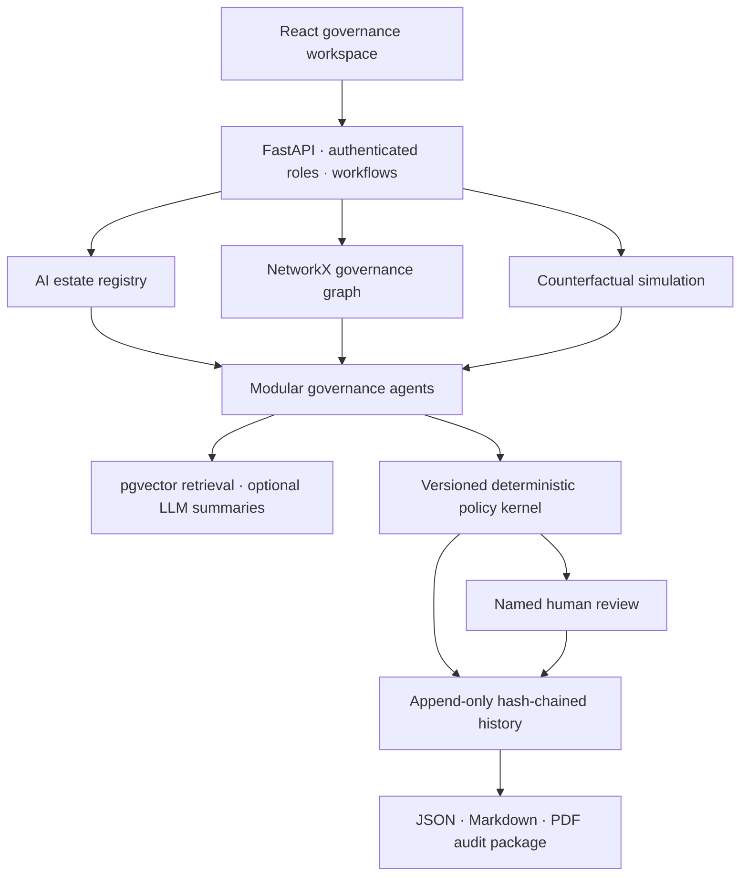

# GovernSim

**A predictive governance digital twin for enterprise AI.**

GovernSim connects an AI estate to representative requirements, controls, evidence and human decisions. Its what-if simulator answers: **what needs to be reassessed if this model, geography, permission, data source or policy changes?**

This is a deployable **local MVP**. It is decision support, not legal advice, a legal applicability engine, an ISO certification or a production enterprise compliance platform. The included enterprise records and attestations are **synthetic demo fixtures**.

## What works

- Light/dark console themes with saved preference, responsive navigation, keyboard tabs and command search.
- Seven React workspaces: AI estate, asset profile/graph, evidence, what-if simulator, change impact, human review and audit packages.
- Invite-only email/password login, mandatory authenticator-app two-factor verification, one-use recovery codes, expiring HttpOnly-cookie sessions and server-side logout.
- FastAPI API with server-verified roles: AI owner, risk officer, compliance reviewer, auditor and admin.
- Five AI assets, ten controls, thirty authored representative requirements and twenty-five synthetic evidence artifacts.
- Versioned deterministic assessments with five statuses: `COMPLIANT`, `EVIDENCE_GAP`, `HUMAN_REVIEW_REQUIRED`, `CONDITIONAL_APPROVAL`, `BLOCKED`.
- Evidence hashes, freshness/expiry checks, independent verification, coverage metadata and scoped version invalidation.
- Isolated simulations for geography, model/provider, data, permissions, autonomy, prompts, incidents and policy profiles.
- Recorded registry changes reassess transitive dependent assets.
- Mapping proposals require a different named reviewer before activation.
- Hash-chained append-only history, decision snapshots and reviews, plus JSON, Markdown and PDF exports.
- PostgreSQL + pgvector via Docker Compose; SQLite and local cosine retrieval for a quick setup.
- Optional grounded OpenAI or Anthropic summaries. No paid API or model key is needed in offline mode.

## Architecture



LLM output cannot enter the deterministic status calculation. A summary with unknown citation IDs is rejected. Identifier validation does **not** establish semantic entailment; summaries still require human verification.

## Windows: use your Documents\GovernSim folder

Clone [kar151A/GovernSim](https://github.com/kar151A/GovernSim) into `Documents\GovernSim`, or extract the source archive there. `README.md`, `compose.yaml`, `backend` and `frontend` should be directly inside the folder.

### Option A — Docker Desktop (PostgreSQL + pgvector)

Requires Python 3.12+ for credential generation and Docker Desktop with Linux containers.

```powershell
cd "$env:USERPROFILE\Documents\GovernSim"
py -3.12 scripts\bootstrap.py
docker compose up --build -d
```

Create your first account in the Compose database:

```powershell
docker compose exec app python scripts/manage_users.py invite --email your-email@example.com --role ADMIN
```

Open **http://localhost:8000**, choose **Set up invited account**, enter your email and invitation code, create a password, and scan the QR code in your authenticator app. Enter the six-digit code and save the one-use recovery codes. Additional accounts receive roles from the local administrator; there is no public registration.

```powershell
# See health and startup errors
docker compose ps
docker compose logs -f app

# Stop the app; the named database volume is retained
docker compose down
```

Do not add `-v` unless you intentionally want to delete the database volume.

### Option B — Python + Node, no Docker

Requires **Python 3.12** and **Node.js 22+**. This path uses SQLite, NetworkX and offline lexical embeddings.

```powershell
cd "$env:USERPROFILE\Documents\GovernSim"
py -3.12 -m venv .venv
.\.venv\Scripts\python.exe scripts\bootstrap.py
.\.venv\Scripts\python.exe -m pip install -r backend\requirements.txt
npm.cmd ci --prefix frontend
npm.cmd run build --prefix frontend
.\.venv\Scripts\python.exe scripts\manage_users.py invite --email your-email@example.com --role ADMIN
.\.venv\Scripts\python.exe -m uvicorn app.main:app --app-dir backend --host 127.0.0.1 --port 8000
```

The invitation command above creates the first administrator account setup code. Replace the example email with your own account identifier.

Open **http://localhost:8000** and choose **Set up invited account**. Enter the locally generated invitation, set a password of at least 15 characters, and complete authenticator setup. Save the recovery codes. Later visits use **email + password + authenticator code**. No virtual-environment activation is necessary when you call its Python executable directly. See [account setup](docs/AUTHENTICATION.md).

A convenience launcher is included at `scripts\start-local.ps1`; the explicit commands above also work when PowerShell script execution is restricted. Linux/macOS: `bash scripts/start-local.sh`.

For UI development, run the backend on port 8000 and `npm.cmd run dev --prefix frontend` in another terminal. Open Vite's local URL; `/api` requests are proxied to the backend. Rebuild the UI before serving it from FastAPI.

## First demo

1. Sign in with an enrolled **AI_OWNER** or **ADMIN** account and its authenticator code. The seeded India customer-support agent meets the representative controls using synthetic evidence.
2. Open **What-if simulator**, choose that agent, and run the preset EU deployment scenario.
3. Inspect new privacy/transparency requirements, newly insufficient scopes and remediation. EU deployment does not automatically establish an AI Act high-risk use case.
4. Inspect **Evidence** and the source/hash/scope of an artifact. New artifacts always start unverified.
5. Register a high-risk asset or simulate/record an incident. Run an assessment, then sign in with a separate **COMPLIANCE_REVIEWER** account to record a justified review.
6. Open **Audit packages** and download JSON, Markdown or PDF. Export the full chain and retain its head hash independently.

An executable walkthrough against your running local API is available:

```powershell
.\.venv\Scripts\python.exe scripts\demo.py
```

This legacy automation walkthrough requires explicit `GOVERNSIM_ALLOW_LEGACY_API_KEYS=true` and the generated local tokens. That mode bypasses browser MFA and is disabled by default. Leave it disabled when using account authentication. The script registers a new demo agent and writes packages to ignored `artifacts/`.

## Tests and evaluation

```powershell
.\.venv\Scripts\python.exe -m pip install -r backend\requirements-dev.txt
.\.venv\Scripts\python.exe -m pytest backend\tests -q
.\.venv\Scripts\python.exe scripts\evaluate.py
npm.cmd run build --prefix frontend
```

See [evaluation/REPORT.md](evaluation/REPORT.md), [evaluation/metrics.json](evaluation/metrics.json) and [docs/VERIFICATION.md](docs/VERIFICATION.md). Metrics are measured on small synthetic fixtures; they are not production accuracy estimates. Type compatibility is not a validated semantic mapping benchmark.

A PostgreSQL test is skipped unless `TEST_POSTGRES_URL` points at a **disposable** database. GitHub Actions defines SQLite, PostgreSQL/pgvector and frontend-build jobs. Check the Actions run on the exact commit you intend to use; local results and older successful runs do not establish the result for a newer commit.

## Update an existing checkout

From the project root, commit or preserve any local changes before pulling:

```powershell
git pull --ff-only origin main
npm.cmd ci --prefix frontend
npm.cmd run build --prefix frontend
```

Start the backend with the command in Option B and refresh the browser. Use the moon/sun control in the console header to choose an appearance; the sign-in screen has the same control. Database records and generated local credentials are excluded from Git updates.

For frontend development, `npm run dev:ui` starts Vite while the API runs separately on port 8000. `npm run preview:ui` previews a compiled frontend; use FastAPI for full API workflows.

See [CONTRIBUTING.md](CONTRIBUTING.md), [scripts/README.md](scripts/README.md), and [docs/UI_DESIGN.md](docs/UI_DESIGN.md) for change, command and design guidance.

## Configuration

`python scripts/bootstrap.py` preserves existing configuration and adds a persistent random `GOVERNSIM_AUTH_KEY` during upgrades if absent. This key encrypts authenticator secrets; back it up securely with the database. It also generates the local database password and optional legacy automation tokens on fresh setup. Legacy bearer-token access is disabled by default. `.env` and `.local-keys.txt` are excluded from Git and Docker builds.

| Variable | Purpose |
| --- | --- |
| `GOVERNSIM_AUTH_KEY` | Persistent Fernet encryption key generated by bootstrap. Required for account authentication. |
| `GOVERNSIM_AUTH_COOKIE_SECURE` | Set `true` with HTTPS hosting; loopback HTTP development uses `false`. |
| `GOVERNSIM_AUTH_ORIGINS` | Exact comma-separated trusted browser origins, including scheme and port. |
| `GOVERNSIM_ALLOW_LEGACY_API_KEYS` | Default `false`. Enabling this explicitly permits old automation tokens to bypass MFA. |
| `GOVERNSIM_API_KEYS` | Legacy SHA-256 token-to-role mapping, used only when that opt-in is enabled. |
| `POSTGRES_PASSWORD` | Generated hexadecimal password used by Compose. |
| `DATABASE_URL` | SQLAlchemy URL; omitted for local SQLite, supplied automatically by Compose. |
| `SEED_DEMO` | Explicit synthetic seeding; bootstrap enables it for the demo. Set `false` before a clean non-demo deployment. |
| `LLM_PROVIDER` | `offline` (default), `openai` or `anthropic`. |
| `LLM_API_KEY`, `LLM_MODEL` | Needed only for optional online summaries; choose a model available to your account. |

Changing a PostgreSQL password in `.env` does not rotate a password already initialized in an existing database volume. Rotate it within PostgreSQL and then update configuration.

## Implementation guide

```text
backend/app/
  main.py       authenticated API and workflows
  schemas.py    strict request validation
  db.py         relational tables and append-only triggers
  catalog.py    controls, representative requirements and policy profiles
  kernel.py     pure deterministic assessment engine
  agents.py     ingestion, indexing, retrieval, mapping proposals, summaries
  service.py    assessment, change impact and isolated simulation
  audit.py      canonical serialization and hash-chain integrity
  seed.py       explicitly synthetic enterprise fixtures
  reports.py    evidence package composition and exports
backend/tests/  regression and opt-in PostgreSQL checks
frontend/src/   typed React workspaces and responsive styles
scripts/        local setup, demo and evaluation
```

API documentation: **http://localhost:8000/docs**. Requests made by the signed-in console use its cookie session and CSRF header. Legacy bearer authorization is available only with the explicit automation opt-in. Root endpoint aliases match the supplied brief; the UI uses `/api/*` to avoid path collisions with frontend assets. See [docs/API.md](docs/API.md).

See [docs/DECISION_MODEL.md](docs/DECISION_MODEL.md) for evidence/review semantics, [docs/SOURCES.md](docs/SOURCES.md) for authority and scope, and [docs/DEPLOYMENT.md](docs/DEPLOYMENT.md) before any hosted deployment.
